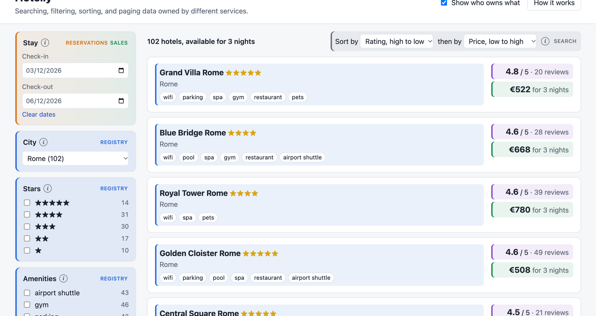

# Hotelly

A showcase demoing hotel booking and management, designed applying service-oriented architecture (SOA) principles.

Hotelly is made of the following services:

- **Registry:** hotels, their location, stars, and amenities.
- **Reservations:** rooms availability and bookings.
- **Marketing:** ratings and reviews.
- **Sales:** nightly rates.

## Searching, paging, and sorting

The first scenario Hotelly demos is a hotel search page: filtering, faceting, sorting, and paging data owned by different services. Each service owns its PostgreSQL server. Search has its own server too, with one schema per service. Each service has a database role that can write only to its own schema, and the search process has a role that can only read.

Services keep their search tables up to date with PostgreSQL logical replication: each service publishes only the columns search needs, and subscribes its schema in the search database to that publication. There's no sync code, and changes arrive in commit order. Publications can also filter rows: Reservations publishes only sold-out nights, the only thing search needs to know about availability. When a booking sells out a night, the row arrives in search as an insert; when a cancellation frees a room, as a delete. The search results page is then composed using [ServiceComposer](https://github.com/ServiceComposer/ServiceComposer.AspNetCore).

## Requirements

- [.NET 10 SDK](https://dotnet.microsoft.com/download)
- [Docker](https://www.docker.com/), or another container runtime supported by [Aspire](https://aspire.dev/)

## How to run

Hotelly uses Aspire to start everything it needs:

```shell
dotnet run --project src/Hotelly.AppHost
```

The Aspire dashboard opens in the browser. From there, pgAdmin gives access to the databases, and the RabbitMQ management UI to the queues the services' back ends and the composition gateway use to exchange messages. The back ends and the gateway are [NServiceBus](https://particular.net/nservicebus) endpoints: NServiceBus needs a license in production, see [Particular's licensing page](https://particular.net/licensing) to try it. The PostgreSQL containers have no data volume: every run starts from scratch, and each service seeds its own data at startup. Hotel IDs are derived from the hotel number, so services agree on them without talking to each other. The seed data is the same at every run: nightly rates and availability cover 12 months, starting from the first day of the current month, and a given night always has the same rate and availability. Searches with stay dates outside those 12 months find no hotels: if the dates in the examples below are in the past, use later ones.

## Try it

The website at <http://localhost:5080> is a search page. Filters, facets, sorts, and paging all go through the composition gateway, and colors show which service owns each filter and each piece of data. The info icons explain how each part works, "How it works" walks through a search from start to finish, and "Under the hood", below the results, shows the request to the gateway and the composed response.



The website is a client of the gateway, like any frontend: it forwards searches to the gateway, so the page only calls its own origin.

The back office, at <http://localhost:5080/back-office.html>, adds hotels and edits them: every search result links to it. See [the back office](#the-back-office) below.

The composition gateway exposes the search at `/search`. For example, hotels in Rome with 4 or 5 stars and a pool, available from February 12 to 15, 2027, sorted by stars, then by rating:

```shell
curl "http://localhost:5100/search?city=Rome&stars=4,5&amenities=pool&checkIn=2027-02-12&checkOut=2027-02-15&orderBy=stars:desc,rating:desc"
```

The response contains a page of hotels, the total number of matching hotels, and the facets. `checkIn`, `checkOut`, `orderBy`, `page`, and `pageSize` are reserved; every other parameter is a filter, handled by the service that owns it.

## Composing the results page

The search only returns hotel IDs. The gateway uses [ServiceComposer](https://github.com/ServiceComposer/ServiceComposer.AspNetCore) to turn them into a results page: the search handler runs the search, then raises a `HotelsFound` event with a view model for each hotel on the page. Services subscribe to it, load what they own for the whole page with a single query, and add it to the hotels' view models. Registry adds the name, city, stars, and amenities. Sales adds the price: with stay dates, the price of the stay; without, the "from" price, the lowest nightly rate in the next 30 days. Marketing adds the average rating and the number of reviews. Prices and ratings are the same ones the price and rating sorts use, computed from each service's own database rather than from search's copy.

Composition handlers are part of their services, deployed in the gateway, like search providers. They read straight from their service's own database, not from the search database, which only has what search needs. Each service creates a role for its composition handlers that can only read. Calling the service's API would work too, at the cost of an endpoint that exists only for composition, and a network hop. Reading the database directly makes the database schema a contract between two parts of the same service, deployed separately: a schema change means deploying the composition handlers too.

## Search providers

Services take part in the search by deploying providers in the composition gateway, the same way they deploy composition handlers. The search process starts from the hotels, provided by Registry, and knows nothing about the services' data: providers build the queries, and everything runs in the search database.

- **Filters:** every filter provider runs on every request. Each one reads the filters it owns, like `city` or `amenities`, and does nothing when they're missing.
- **Facets:** every facet provider runs on every request, over the filtered hotels, before paging.
- **Sorts:** only the requested ones run, in the requested order. `orderBy=stars:desc,price` sorts by stars first, then by price. That's why sort providers expose a `Key`: the search process picks the provider for each requested key, and tells it whether it's the first sort (`OrderBy`) or a following one (`ThenBy`). Without keys, providers owned by different services would have to agree among themselves on who goes first. Keys also make conflicts visible: if two services claim the same key, the gateway fails at startup.

Filter names and sort keys are the contract search imposes on services and on the UI. Hotelly is a demo, so filters don't declare their names: unknown filters are silently ignored, and nothing detects two services handling the same filter. Giving filter providers a key, like sort providers, would fix both.

## The back office

The second scenario is the back office hotel managers use to add and edit hotels. A hotel's data belongs to four services, and so does the page: each service contributes a panel with the data it owns.

- **Registry:** the name, city, stars, amenities, and description.
- **Sales:** the nightly rates for the next two weeks, and a form to set a rate for a range of nights.
- **Reservations:** the rooms and bookings for the next two weeks, and a form to set the rooms for a range of nights. A night can't have fewer rooms than bookings: it keeps one room per booking, and is sold out.
- **Marketing:** the rating and latest reviews. Guests write reviews, not hotel managers, so the panel is read-only.

Each service owns three pieces of the page, and none of them runs in the service's own back end:

- **A panel**, a JavaScript module, shipped as a Razor class library (`Registry.BackOffice`, `Sales.BackOffice`, and so on). The website references the libraries and registers their panels, and the back office page loads them. The page is a shell: it knows nothing about hotels.
- **Composition handlers for reads**, in the composition gateway, loading the panel's data from the service's database with a read-only role, like the search results.
- **Composition handlers for writes**, in the composition gateway too, turning the panel's form into a command for the service's back end. They validate what they receive, and reject it with a `400`.

The back ends and the gateway exchange messages through RabbitMQ. The back ends handle the commands idempotently, and logical replication takes the changes to search: a hotel added in the back office shows up in the search results.

### Adding a hotel

Adding a hotel is one request, `POST /back-office/hotels/{id}`, with a part for each service:

```json
{
  "registry": { "name": "Hidden Garden Rome", "city": "Rome", "stars": 4, "amenities": ["wifi", "pool"] },
  "sales": { "nightlyRate": 150 },
  "reservations": { "rooms": 20 }
}
```

Each service's composition handler binds only its own part, with ServiceComposer's declarative model binding, and sends its own command: `AddHotel` to Registry, `SetNightlyRates` to Sales, `SetRooms` to Reservations. [Heyi](https://github.com/mauroservienti/Heyi) wraps the request in an NServiceBus transactional session, backed by the gateway's own database and the outbox: all the commands are sent, or none. If Sales rejects the rate, Registry's `AddHotel` isn't sent either.

The page generates the hotel ID, so the services can store their data for the same hotel without waiting for Registry, and sends it as the idempotency key too: Heyi uses it as the ID of the messages, so retrying the request doesn't send them twice.

Editing is one request per panel, for example `POST /back-office/hotels/{id}/sales`, handled by one service's composition handler.

### Eventual consistency

The gateway only sends commands: the back ends apply them a moment later. After adding a hotel, the page opens it, and retries for a few seconds until Registry has it. After saving a panel, the panel says the change is on its way.

Committing the transactional session sends a control message to the gateway itself, to dispatch the outbox. If it arrives before the outbox record is stored, it's delayed by the commit delay increment. The default, 2 seconds, made changes take about 4 seconds to reach the back ends with RabbitMQ's delayed delivery. The gateway uses 100 milliseconds: RabbitMQ delays in whole seconds, so it takes about 1.

### Delivering the components

In Hotelly, everything lives in one repository, and the website and the gateway reference the services' projects. In a real system, each service would publish its panel and its composition handlers as packages, and the website and the gateway would reference them like any other dependency. A new version of Registry's panel then reaches production when the website picks up the new package, and is rebuilt and redeployed.

